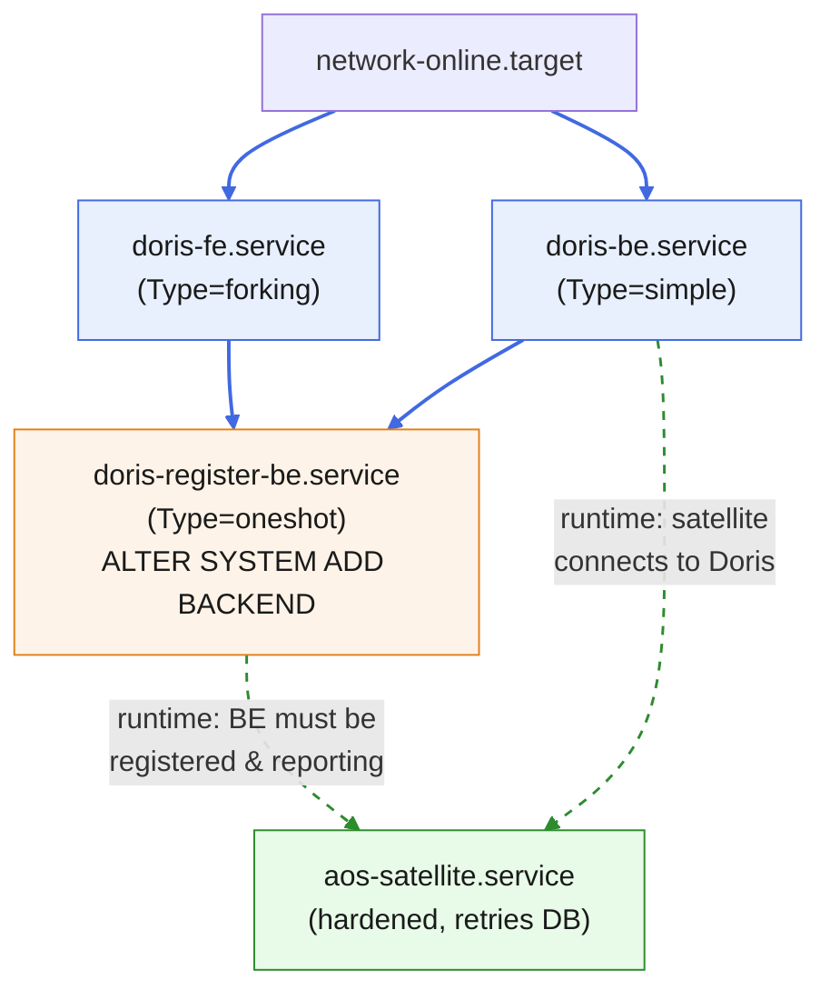

# AOS Satellite Host Package

This project builds a bootable Linux appliance image. The image bundles the Autonomous
Operations (AOS) satellite together with its operating system as a single, reproducible
unit. The satellite ships as a cryptographically signed artifact, and the build verifies
that signature before it packages anything.

The image uses [NixOS](https://nixos.org), a Linux distribution that describes the whole
system declaratively. You write what the system should contain, and Nix produces the exact
same result every time. This gives three properties the appliance needs: reproducible
builds, atomic upgrades, and offline (air-gapped) delivery. See
[ADR-024](https://pages.github.tools.sap/autonomous-operations/autonomous-operations/#/architecture/specifications/spec-ao/adrs/adr-024)
for the architecture decision that mandates this design.

> [!TIP]
> This README uses several Nix and NixOS terms (flake, closure, derivation, store).
> If these are new to you, watch [this short introduction](https://www.youtube.com/watch?v=5D3nUU1OVx8)
> first. The [How to run](#how-to-run) section below works without that background;
> the [Documentation](#documentation) section assumes it.

---

## How to run

This section takes you from a clean machine to a booted VM with a login shell. It targets
an Apple Silicon Mac, which is the current development setup.

### What you get

`mise run run` builds a **debug** image and boots it on your Mac under QEMU. You land at a
serial login prompt inside the running appliance. The debug image is the hardened
appliance plus break-glass console access, so you can inspect it. The published image has
no login by design.

### Prerequisites

Install these on the host first:

| Dependency | Why | Install |
| --- | --- | --- |
| [mise](https://mise.jdx.dev) | Runs the project's build tasks and pins the `ocm` CLI. | `brew install mise` |
| A Docker-compatible container runtime | Hosts the Linux container that **is** the Nix builder. Any runtime the `docker` CLI can drive works. On Linux, native Docker or Podman. On macOS, [Colima](https://github.com/abiosoft/colima), Docker Desktop, Rancher Desktop, or OrbStack — macOS needs one of these because it runs Linux containers in a VM. | `brew install colima docker` (one option) |
| [QEMU](https://www.qemu.org) | Boots the built image on macOS. The `run` task also needs the bundled EDK2 UEFI firmware. | `brew install qemu` |

The build only needs a daemon the `docker` CLI can reach, running **Linux** containers —
the builder image (`nixos/nix`) is Linux-only. The tasks call `docker run` and nothing
runtime-specific, so Colima is a convenient macOS choice, not a requirement. `mise` does
not manage the container runtime or QEMU, so you install those yourself. The `run` task
expects the firmware at `/opt/homebrew/share/qemu/edk2-aarch64-code.fd`, which the
Homebrew `qemu` formula provides.

### Setup

1. Start your container runtime and confirm it runs. With Colima on macOS:

   ```sh
   colima start
   colima status
   ```

   On Linux with native Docker, confirm the daemon is up instead (`docker info`).

2. Install the pinned tools from `.mise.toml`:

   ```sh
   mise install
   ```

3. Confirm the Nix builder container works:

   ```sh
   mise run nix-shell-up
   ```

   This starts the pinned `nixos/nix` container over your runtime and prints the Nix
   version. The first run downloads the container image and can take a few minutes.

### Boot the VM

Run:

```sh
mise run run
```

The task does four things in order:

1. Builds the debug image inside the Nix container.
2. Finds the resulting `qcow2` disk image in the Nix store.
3. Copies that image out to `.run/satellite-host-debug.qcow2` (a scratch file, never
   committed).
4. Boots it with `qemu-system-aarch64 -accel hvf`, with the serial console attached to
   your terminal.

When the boot finishes, log in at the serial prompt:

- **Username:** `root`
- **Password:** `nixos`

To quit QEMU, press `Ctrl-a` then `x`. The task also forwards host port `2222` to the
guest's SSH port, so `ssh -p 2222 root@localhost` reaches the VM once you enable SSH.

> [!NOTE]
> The first `mise run run` is slow because it builds the full image closure (roughly
> 8 GB). Later runs reuse the Nix store cache and finish in a couple of minutes.

### Free up disk space

Each image build adds a full closure to the Nix store volume, which fills over time. When
a build fails with `No space left on device`, reclaim space:

```sh
mise run gc
```

This garbage-collects unreferenced store paths and repairs the container's profile link
that the collection would otherwise break.

### Verify the services

The appliance runs the satellite plus an [Apache Doris](https://doris.apache.org)
database (one Frontend and one Backend). After boot, check them from the VM shell:

```sh
systemctl is-active doris-fe doris-be doris-register-be
mysql -h127.0.0.1 -P9030 -uroot -e "SHOW BACKENDS\G"
```

A healthy backend shows `Alive: true` and a non-zero `TotalCapacity`.

---

## File structure

```
tools/nixos/               # This flake, inside the autonomous-operations-satellite repo.
├── flake.nix              # Entry point: declares packages, the image, and the NixOS system.
├── flake.lock             # Pins every input by hash (a supply-chain control). Commit this.
├── .mise.toml             # Build tasks and the pinned toolchain (ocm CLI, Nix builder image).
├── nix/
│   ├── satellite-ctf.nix      # Unpacks the signed artifact and verifies its signature at build time.
│   ├── satellite-package.nix  # Extracts the satellite binary from the verified artifact.
│   ├── module.nix             # NixOS module: the hardened satellite systemd service.
│   ├── doris.nix              # Packages Apache Doris from the upstream release tarball.
│   ├── doris-module.nix       # NixOS module: the Doris Frontend and Backend services.
│   ├── fips.nix               # FIPS 140 crypto mode wiring.
│   ├── debug.nix              # Break-glass console access for the debug image only.
│   ├── image.nix              # Builds the bootable qcow2 image (host-side, no nested VM).
│   ├── boot-test.nix          # NixOS VM test asserting runtime invariants.
│   └── ocm.nix                # Pins the OCM CLI used by the build.
├── vendor/                # The signed satellite artifact and its public key (see below).
└── .run/                  # Scratch output of `mise run run` (git-ignored, multi-GB).
```

## Architecture and boot sequence

Four systemd units bring the appliance up: the Doris Frontend (FE) and Backend (BE), a
one-shot that registers the BE with the FE, and the satellite itself. Their start order
matters, and two different kinds of dependency are at play:

- **Ordering (systemd `after`/`wants`)** — a hard edge the init system enforces.
- **Runtime dependency** — a soft edge the application enforces by retrying. The satellite
  has **no** systemd dependency on Doris; it simply retries its database connection until
  Doris is ready.



Solid arrows are systemd ordering edges; dashed arrows are runtime dependencies that the
application resolves by retrying.

Two consequences worth internalizing:

1. **FE and BE start in parallel.** Neither orders after the other. The FE learns about the
   BE only through the `doris-register-be` one-shot, not through startup order.
2. **The satellite does not wait on Doris via systemd.** It is only ordered after
   `network.target`, so it may start before Doris is ready and log "waiting for Doris
   backend" until the cluster forms. This is intentional — it decouples the satellite's unit
   from Doris's readiness and survives Doris restarts.

---

## Artifact source: `vendor/` today, GitHub later

The build reads the signed satellite artifact from the local `vendor/` directory today.
This keeps the build fully offline while the artifact has no public home yet.

The source is a **one-line toggle** in `nix/satellite-ctf.nix`. When the artifact moves to
a GitHub release, you switch from the vendored file to a `fetchurl` download:

```nix
# Today — vendored, offline:
ctfTgz = ../vendor/f5-vlan-demo-satellite-0.0.3.ctf.tgz;

# Later — a published GitHub release:
# ctfTgz = pkgs.fetchurl {
#   url  = "https://github.com/<org>/<repo>/releases/download/v0.0.3/f5-vlan-demo-satellite-0.0.3.ctf.tgz";
#   hash = "sha256-<SRI of the vendored tgz>";
# };
```

Both paths pin the **same** `sha256` hash, so the downstream build is byte-identical and
the switch is invisible to everything else. The build-time signature check is unchanged
either way, so provenance holds regardless of where the bytes come from.

Phasing out `vendor/` is the intended direction. The vendored tarball is a stopgap; the
GitHub release is the destination. Nothing else in the build needs to change when you make
the switch.

---

## Documentation

This section is the detailed technical reference. It assumes familiarity with Nix. It
preserves the original design notes for maintainers.

### What this builds

| Flake attribute | What it is |
| --- | --- |
| `packages.<system>.ctf-verified` | Unpacks the OCM CTF in a **sha256-gated + `ocm verify` signature-gated** manner at build time (step 1). Independently buildable security gate. |
| `packages.<system>.satellite` | Sets up the payload binary, extracted from the *verified* CTF (step 2). `default`. |
| `apps.<system>.default` | `nix run` entry point → runs the verified satellite. |
| `nixosModules.default` | Hardened systemd service for the satellite (step 3). Self-sufficient: `enable = true` is enough. |
| `nixosConfigurations.satellite-host` | The air-gapped `nixos-rebuild switch` toplevel closure; boots with `fips=1` (step 4). |
| `packages.<system>.image` | The bootable `qcow2` appliance image, built host-side via `systemd-repart` (see [Image build](#image-build)). `image-qcow` is an alias. |
| `packages.<system>.image-debug` | The same image plus `nix/debug.nix` (serial console + root password). What `mise run run` boots. |
| `checks.<system>.boot-test` | NixOS VM test: boots the host, asserts **FIPS active** + hardened service running (ADR-024). |
| `devShells.default` | `ocm` + `nixos-generators`. |

`<system>` specifies the architecture. It is either `aarch64-linux` (native when the
container runtime's VM is arm64, as on Apple Silicon) or `x86_64-linux` (binfmt/QEMU). CTF stands for the OCM Common Transport Format, the
on-disk layout of the signed artifact.

### Consuming this flake from GitHub

This flake lives in a subdirectory of a larger repository:
`github.com/autonomous-operations-platform/autonomous-operations-satellite`, under
`tools/nixos`. A flake in a subdirectory needs the `?dir=` fragment in its reference, so
the flake URL is:

```
github:autonomous-operations-platform/autonomous-operations-satellite?dir=tools/nixos
```

Pin a tag or commit by appending it before the `?`, for example
`…/autonomous-operations-satellite/v0.0.3?dir=tools/nixos`.

There are two ways to consume it, and both work from the same flake.

#### A. Use the package on an existing NixOS / Nix distribution

This path has three levels, from "just the binary" to "the satellite service plus Doris".
Pick the one that matches what you need. Each level builds on the one before it.

##### A1. Install only the satellite binary (`nix profile install`)

```sh
# Install the verified satellite binary into your Nix profile:
nix profile install "github:autonomous-operations-platform/autonomous-operations-satellite?dir=tools/nixos"

# …or just run it without installing:
nix run "github:autonomous-operations-platform/autonomous-operations-satellite?dir=tools/nixos"
```

Quote the ref on the command line so the shell does not treat `?` as a glob.

**What this installs:** only the satellite executable, placed in your Nix profile
(`~/.nix-profile/bin/<satellite>`). That is all.

**What this does NOT do:** it does **not** install Doris, and it does **not** create any
systemd unit, service user, or hardening. `nix profile install` installs a *package*; it
never touches system configuration. Doris is a separate package (`packages.<system>.doris`)
that the satellite binary does not depend on, so it is never fetched here.

**About the OCM artifact:** building the binary still runs the full supply-chain chain on
your machine, so the OCM artifact **is** fetched and verified as a *build input* — today
from the flake's `vendor/` directory (Nix fetches the repo tree to get it), or from a
GitHub release once the source toggle is flipped to `fetchurl`. Both run the same two gates
(sha256 byte-integrity + `ocm verify` RSASSA-PSS) on your box, so provenance is enforced at
install time, not just in CI. The artifact ends up as an intermediate store path, not
something in your profile. This needs network (GitHub + `cache.nixos.org`) or a configured
substituter; on an air-gapped host, populate the local substituter first (the ADR-024 path).

##### A2. Run the satellite as a hardened systemd service

To get the **systemd unit** (dedicated user, seccomp, dropped capabilities) instead of an
ad-hoc binary, add the satellite module to a NixOS host config and `nixos-rebuild switch`.
The module is self-sufficient, so `enable = true` is all it needs:

```nix
{
  inputs.aos.url = "github:autonomous-operations-platform/autonomous-operations-satellite?dir=tools/nixos";

  outputs = { self, nixpkgs, aos, ... }: {
    nixosConfigurations.my-host = nixpkgs.lib.nixosSystem {
      system = "x86_64-linux";
      modules = [
        aos.nixosModules.default
        ({ ... }: {
          services.aosSatellite.enable = true;   # package defaults to the verified build
          # Optional: pin a prebuilt closure instead (air-gapped / local substituter):
          # services.aosSatellite.package = <prebuilt>;
        })
        ./hardware-configuration.nix
      ];
    };
  };
}
```

Then `sudo nixos-rebuild switch --flake .#my-host`.

**What this installs:** the `aos-satellite.service` systemd unit and its service user, with
the verified satellite as the executable. The OCM artifact is fetched and verified exactly
as in A1 (it is a build input of the package the service runs).

**What this does NOT do:** it still does **not** bring Doris. `nixosModules.default` wires
*only* the satellite service — Doris lives in a separate module (see A3).
`services.aosSatellite.package` defaults to the verified satellite built for the host's own
`pkgs.system`, so you do not replicate the pinned-OCM overlay wiring. FIPS
(`boot.kernelParams = [ "fips=1" ]`) is **not** forced by the module — it is a whole-host
decision; set it yourself if you want it (as `nixosConfigurations.satellite-host` does).

##### A3. Add Doris (the full service stack)

The appliance also runs Apache Doris. To reproduce that on your own host, add the **second**
module, `nixosModules.doris`, and enable it alongside the satellite:

```nix
modules = [
  aos.nixosModules.default      # satellite service
  aos.nixosModules.doris        # Doris Frontend + Backend services
  ({ pkgs, ... }: {
    services.aosSatellite.enable = true;
    services.doris.enable = true;             # brings the doris-fe, doris-be,
                                              # and doris-register-be units
    # Doris pulls its JDK and prebuilt binaries as package dependencies; size the
    # FE heap / BE memory for the host if the ~8 GiB defaults do not fit:
    # services.doris.feHeap = "2048m";
    # services.doris.beMemLimit = "4G";
  })
  ./hardware-configuration.nix
];
```

**What this installs:** the `doris-fe`, `doris-be`, and `doris-register-be` systemd units in
addition to the satellite service. Enabling `services.doris` builds `packages.doris` (the
patched upstream Apache Doris, see [Doris services](#doris-services)) and its JDK as normal
package dependencies — so `nixos-rebuild switch` fetches and builds them during activation.
The `doris-register-be` one-shot forms the single-node cluster on first boot.

> **Doris reuses the satellite's service user.** `services.doris.user` defaults to
> `aos-satellite` and must already exist — the satellite module (`nixosModules.default`,
> enabled above) creates it. If you enable Doris without the satellite module, either keep
> that module or set `services.doris.user`/`.group` to an existing user you provide.

> **Simpler alternative.** If you want the *whole* tested appliance (satellite + Doris +
> FIPS wiring) rather than assembling modules yourself, consume the complete system from
> path B instead — `nixosConfigurations.satellite-host` already composes all of it.

#### B. Build the combined image / A/B-switch closure (ADR-024 delivery)

```sh
AOS="github:autonomous-operations-platform/autonomous-operations-satellite?dir=tools/nixos"
nix build "$AOS#image"          # the bootable qcow2 appliance image
nix build "$AOS#nixosConfigurations.satellite-host.config.system.build.toplevel"
```

This is the combined OS+satellite closure: `nixos-rebuild switch --flake` it onto the
target for atomic, generation-based rollback, or deploy the image directly.

> **A vs. B.** B couples the satellite version to the OS generation (ADR-024 combined
> delivery). A lets an *existing* fleet machine pull just the verified satellite without
> re-imaging — same provenance gates, looser coupling. Use B for the appliance; use A to
> run the satellite on a host someone else manages.

### Supply-chain guarantees

| Gate | Mechanism | Fails build when |
| --- | --- | --- |
| Input reproducibility | `flake.lock` pins nixpkgs + all inputs by hash | an input's content changes |
| Toolchain pinning | `ocm` 0.15.0 pinned (mise + Nix FOD overlay); Nix image pinned by **digest** | the verifier/toolchain drifts |
| **Byte integrity of CTF** | fixed-output sha256 (`fetchurl` hash, or the `sha256sum -c` gate in `satellite-ctf.nix` on the vendored path) | tarball bytes ≠ pinned hash |
| **Provenance of satellite** | `ocm verify component-version` RSASSA-PSS vs `vendor/satellite.pub.pem` at build | signature invalid/absent |
| Output integrity | Nix content-addressed store | any derivation output tampered |

> **Why two integrity gates, not one.** `ocm verify` signs only the component
> *descriptor's* normalised form — it does **not** re-hash resource blobs, and
> `ocm download` does not either (both confirmed live with ocm 0.15.0). A byte flipped
> inside a resource blob leaves the descriptor and its signature valid. The sha256 gate
> over the whole tarball (the `fetchurl` hash on the GitHub path, or the explicit
> `sha256sum -c` in `nix/satellite-ctf.nix` on the vendored path) is what catches blob
> tampering. Provenance (`ocm verify`) and byte-integrity (sha256) are therefore
> independent and both load-bearing.

### Build environment (mise + containerized Nix)

A macOS host has no Nix. mise orchestrates a pinned Linux container that owns a real
`/nix` and **is** the Linux builder — NixOS images build natively inside it (arm64 when
the runtime's VM is arm64), so no Darwin `linux-builder` cross-build machinery is needed.

`.mise.toml` pins:
- the `ocm` CLI (`github:open-component-model/open-component-model@0.15.0`) for Mac-side
  verify/inspect helpers — matching the in-container verifier;
- the Nix builder image **by digest** (`nixos/nix:2.31.2@sha256:29fc5fe…`), itself a
  supply-chain control for the build toolchain.

Tasks (wrap the container against `/work` with a persistent `aos-nix-store` Docker volume):

```sh
mise run nix-shell-up    # start the pinned Nix container; confirm flakes enabled
mise run verify-ctf      # build the standalone signature-verification gate
mise run build           # nix build .#packages.<system>.satellite
mise run toplevel        # the air-gapped nixos-rebuild switch closure
mise run image           # the bootable qcow2 appliance image
mise run run             # build the debug image and boot it under QEMU (see How to run)
mise run gc              # garbage-collect the Nix store volume and repair the profile link
mise run boot-test       # NixOS VM test (FIPS + service assertions)
```

Prerequisite: the container runtime must be running (e.g. `colima status`, or
`docker info` on native Docker).

### Image build

`nix/image.nix` builds the `qcow2` image with `systemd-repart` running as plain host-side
userspace. It does **not** boot a nested QEMU VM to lay down the filesystem.

This matters on Apple Silicon. The usual `nixos-generators` `qcow` format calls nixpkgs
`make-disk-image.nix`, which boots an inner QEMU VM to install the bootloader. That inner
VM has no nested hardware virtualization on a Mac, so it falls back to slow software
emulation (TCG), and a full image build takes roughly 40 minutes. The `systemd-repart`
path has no inner VM, so the build is bounded by copying the closure — a few minutes.

Two container flags make `repart`'s `unshare` call work under Docker's default sandbox,
both set by the `image` and `run` tasks:

- `--security-opt seccomp=unconfined` — Docker's default seccomp profile blocks `unshare`.
- `--option sandbox false` — so `repart`'s `unshare` is not nested inside Nix's own
  sandbox namespace, which denies nesting.

The result is a UEFI + Unified Kernel Image (UKI) layout that boots directly under
`qemu-system-aarch64 -machine virt`.

#### What the artifact is

`mise run image` (or `nix build .#image`) produces a Nix store directory containing a
single file: **`satellite-host.qcow2`**. Its shape:

- **Format:** `qcow2`. **Architecture:** `aarch64` (see [Limitations](#limitations-and-other-formats)).
- **Firmware:** **UEFI only.** The image has no legacy/BIOS boot path. It needs an aarch64
  UEFI firmware (EDK2 / AAVMF) at boot.
- **Boot path:** a GPT disk with two partitions — an ESP (FAT) holding
  `/EFI/BOOT/BOOTAA64.EFI` (systemd-boot) and a UKI under `/EFI/Linux/`, plus an `ext4`
  root labelled `nixos`. Because the bootloader sits at the UEFI *removable-media* path
  (`BOOTAA64.EFI`), the firmware finds it with no NVRAM boot entry — so the image boots on a
  fresh VM without any host-side `efibootmgr` setup.
- **Login:** none. This is the hardened image. Use `image-debug` (what `mise run run` boots)
  if you need a console.

#### Get the image out of the Nix store

The store lives inside the builder container's volume, so copy the file to a path your
hypervisor can open:

```sh
# Build and print the store path:
OUT=$(mise run image | tail -1)

# Stream the qcow2 out of the store volume to the current directory:
docker run --rm -v aos-nix-store:/nix "$NIX_IMAGE" \
  cat "$OUT/satellite-host.qcow2" > satellite-host.qcow2
```

(`mise run run` already does this for the debug image; the above is the manual equivalent
for the hardened image.)

#### Boot it on a real VM

You need an **aarch64** host or emulator and an **aarch64 UEFI firmware image**. On most
Linux distros the firmware ships as `AAVMF` (`/usr/share/AAVMF/AAVMF_CODE.fd`) or via the
`edk2-aarch64` package; on macOS/Homebrew it is
`/opt/homebrew/share/qemu/edk2-aarch64-code.fd`.

**QEMU directly** (adjust the firmware path):

```sh
qemu-system-aarch64 \
  -machine virt -cpu max -m 8192 -smp 2 \
  -drive if=pflash,format=raw,readonly=on,file=/path/to/edk2-aarch64-code.fd \
  -drive if=virtio,format=qcow2,file=satellite-host.qcow2 \
  -nographic \
  -netdev user,id=net0 -device virtio-net-pci,netdev=net0
```

Use `-cpu max` (software emulation) on a non-aarch64 host, or `-cpu host -accel kvm`
(Linux/aarch64) / `-accel hvf` (macOS/aarch64) for native speed.

**libvirt / `virt-install`** (aarch64 KVM host):

```sh
virt-install \
  --name satellite-host --memory 8192 --vcpus 2 \
  --os-variant nixos-unknown --arch aarch64 --machine virt \
  --boot uefi \
  --disk path=/var/lib/libvirt/images/satellite-host.qcow2,format=qcow2,bus=virtio \
  --network default --graphics none --import
```

`--boot uefi` is mandatory — libvirt then selects the matching AAVMF firmware. `--import`
boots the existing disk rather than running an installer.

#### Convert to another disk format

`qcow2` imports directly into QEMU, libvirt, and most clouds. For hypervisors that want a
different container, convert host-side with `qemu-img` (the data and partition layout are
unchanged):

```sh
qemu-img convert -f qcow2 -O raw   satellite-host.qcow2 satellite-host.raw    # raw / dd-able
qemu-img convert -f qcow2 -O vmdk  satellite-host.qcow2 satellite-host.vmdk   # VMware / OVA
qemu-img convert -f qcow2 -O vpc   satellite-host.qcow2 satellite-host.vhd    # Hyper-V / Azure
qemu-img convert -f qcow2 -O vdi   satellite-host.qcow2 satellite-host.vdi    # VirtualBox
```

A raw image can be written straight to a disk or passthrough device
(`dd if=satellite-host.raw of=/dev/<disk> bs=4M`), as long as the target boots via UEFI.

#### Limitations and other formats

The current `nix/image.nix` is **aarch64-only and emits qcow2**. There is no build flag to
switch architecture or output format — both are properties of that file:

- **Architecture.** The ESP hardcodes the aarch64 bootloader binaries
  (`BOOTAA64.EFI`, `systemd-bootaa64.efi`). An `x86_64` image needs the `BOOTX64.EFI` /
  `systemd-bootx64.efi` equivalents and `system = "x86_64-linux"`. Generalizing this (select
  the bootloader file by `pkgs.stdenv.hostPlatform`) is a small change but not done yet.
- **Output format.** The derivation converts the raw image to qcow2 unconditionally. The
  raw image is available internally as `config.system.build.image`; to expose raw (or skip
  the conversion), adjust the `runCommand` at the bottom of `nix/image.nix` — or just
  convert the qcow2 with `qemu-img` as above, which needs no rebuild.

### Doris services

The appliance runs Apache Doris alongside the satellite. `nix/doris.nix` packages the
upstream prebuilt release, and `nix/doris-module.nix` wires the Frontend (FE) and Backend
(BE) as systemd services. Several non-obvious points are worth knowing before you change
that module:

- **Upstream binaries are patched for NixOS.** `doris_be` is a generic-Linux ELF.
  `autoPatchelfHook` rewrites its interpreter and library paths to Nix-store equivalents.
- **FE and BE run from a writable copy of their home.** The upstream start scripts write
  logs and a process lock under `DORIS_HOME`, so the module seeds a writable tree under
  `/var/lib/doris` rather than running from the read-only Nix store.
- **`priority_networks` is mandatory.** Without it the FE registers itself as `127.0.0.1`,
  which Doris's internal resolver cannot resolve, so the BE never reports its disks. The
  module derives a routable address at boot and writes it into both configs.
- **A one-shot unit registers the BE with the FE.** Doris does not self-form a single-node
  cluster; `doris-register-be` runs `ALTER SYSTEM ADD BACKEND` once the FE is up.

### FIPS (ADR-024)

FIPS stands for the Federal Information Processing Standards; `fips=1` puts the Linux
kernel's crypto subsystem into its validated mode. `nix/fips.nix` wires it as **two
separable pieces**, because one without the other is a trap:

1. **`boot.kernelParams = [ "fips=1" ]`** — asks the kernel to enter FIPS mode at boot.
   On by default (`services.aosSatellite.fips.enable`).
2. **A kernel rebuilt with `CONFIG_CRYPTO_FIPS`** — what actually makes `fips=1` take
   effect. **Opt-in, OFF by default** (`services.aosSatellite.fips.rebuildKernel`),
   because it forces a full kernel compile.

> **`fips=1` alone is inert.** The stock nixpkgs kernel has no `CONFIG_CRYPTO_FIPS`, so
> the param is silently ignored and `/proc/sys/crypto/fips_enabled` never appears — caught
> by the VM boot test (the service booted fine; the FIPS assertion failed with "No such
> file or directory"). Enabling `CONFIG_CRYPTO_FIPS` on Linux 6.12 also requires
> `CRYPTO_DRBG`, `MODULE_SIG`, and leaving the crypto self-tests on — all handled in
> `nix/fips.nix`.

**As shipped, `fips.rebuildKernel` is OFF**, so `nixosConfigurations.satellite-host` sets
`fips=1` on the stock kernel and **FIPS is NOT active at runtime**. This is deliberate:
the kernel compile is slow (and painfully slow under QEMU/TCG on a dev Mac), and the real
FIPS kernel belongs on the actual appliance target — ideally an `x86_64` / KVM builder
where the compile and VM boot are fast.

**To get real FIPS**, set it on the appliance build and verify:

```nix
services.aosSatellite.fips.rebuildKernel = true;   # triggers the kernel compile
```

```sh
mise run boot-test   # VM test; it enables rebuildKernel and asserts fips_enabled == 1
# or: nix build .#checks.<system>.boot-test
```

Status here: the kernel **config** was validated to build with `CRYPTO_FIPS=y` and its full
dependency chain (cheap, no compile). The booted runtime assertion
(`fips_enabled == 1`) is **not run in this environment** — it needs the full kernel
compile + VM boot, deferred to a KVM-capable builder.

Remaining note for real hardware:
- With a separate `/boot`, FIPS integrity self-checks may also need `boot.initrd` module
  signing / `rd.fips` wiring — verify on the target.

### Publishing (when the OCM artifact goes to GitHub)

1. `ocm transfer` the signed component to `ghcr.io`, and/or attach the `.ctf.tgz` to a
   GitHub Release.
2. Flip the `nix/satellite-ctf.nix` source binding from vendored to `fetchurl`; the
   committed `flake.lock` + the pinned sha256 keep it reproducible.
3. The build-time `ocm verify` is unchanged — provenance is enforced regardless of source.

### Repository notes

This tree lives at `tools/nixos` inside
`github.com/autonomous-operations-platform/autonomous-operations-satellite`. Two things
matter when committing it: **commit `flake.lock`** (input pinning is a supply-chain gate),
and **`git add` the `vendor/*.ctf.tgz`** before building — a flake builds from the tracked
git tree, so an untracked artifact is invisible to the build and fails with `path does not
exist`. Consider tracking the ~5 MB tarball via **git-lfs**; it will be replaced by
`fetchurl` once the artifact is GitHub-published.

### End-to-end verification

1. `mise run nix-shell-up` — confirm `nix --version` and flakes inside the container.
2. **Negative test (the gate is load-bearing):** corrupt one CTF blob byte in a scratch
   copy → `mise run verify-ctf` must fail (sha256 gate). Restore → succeeds.
3. `mise run build` → inspect the extracted satellite binary under `result/bin`.
4. `mise run toplevel` — the air-gapped switch closure builds, with `fips=1` set and the
   satellite running as an unprivileged, seccomp-filtered, cap-dropped user.
5. `mise run image` — the combined OS+satellite `qcow2` image builds host-side via
   `systemd-repart`.
6. `mise run run` — the debug image boots under QEMU; the satellite connects to Doris and
   the Doris FE/BE cluster reports a healthy backend.
7. `mise run boot-test` — NixOS VM test: boots the host (with `fips.rebuildKernel`
   enabled) and asserts **FIPS active** + service running. The booted assertion needs the
   kernel compile + VM boot and is deferred to a KVM-capable builder.
8. `nix flake check` / committed `flake.lock` — flake is consistent; all inputs pinned.
