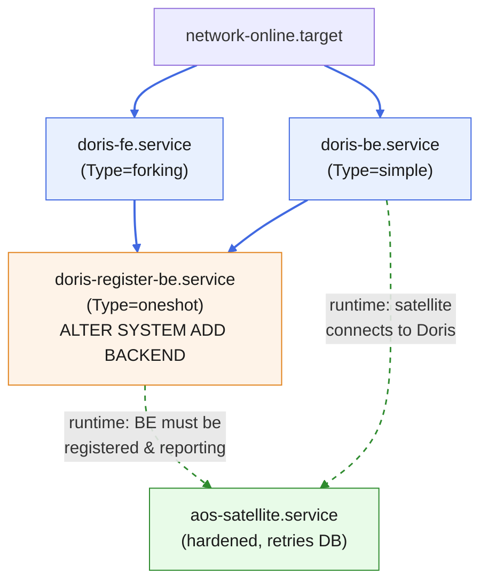

# AOS Satellite Host — NixOS image layer (`tools/nixos`)

This flake builds a bootable Linux **appliance image**. It bundles the Autonomous
Operations (AOS) satellite together with its operating system as a single, reproducible
unit, using [NixOS](https://nixos.org) for reproducible builds, atomic upgrades, and
offline (air-gapped) delivery. See
[ADR-024](https://pages.github.tools.sap/autonomous-operations/autonomous-operations/#/architecture/specifications/spec-ao/adrs/adr-024)
for the architecture decision that mandates this design.

This layer **consumes the package layer** [`../nixpkg`](../nixpkg): it pulls the verified
satellite package and the satellite + Doris NixOS modules from there, and adds the
whole-OS wiring (image assembly, FIPS, boot baseline). Build the individual packages — or
run Doris on a non-NixOS host — from `../nixpkg` instead.

> New to Nix/NixOS? The [How to run](#how-to-run) section works without background; the
> [Documentation](#documentation) section assumes familiarity with flakes and closures.
> [Short intro](https://www.youtube.com/watch?v=5D3nUU1OVx8).

---

## Relationship to the package layer

`flake.nix` declares the package layer as an input:

```nix
inputs.aos-nixpkg.url = "path:../nixpkg";
inputs.nixpkgs.follows = "aos-nixpkg/nixpkgs";   # one shared nixpkgs pin
```

**While developing locally** this is a relative `path:` input, which has two consequences:

- It resolves only when this flake is accessed via the **git tree** (e.g.
  `git+file:///repo?dir=tools/nixos#image`), because a relative path input is resolved
  against the repo, not against a `path:` store copy. The `.mise.toml` image tasks handle
  this (they stage the repo into a scratch git tree).
- It is **not** locked to a revision — the build tracks whatever is on disk in `../nixpkg`.

**Once the package layer is published** (e.g. its own GitHub repo), replace the input with
the published ref and `nix flake update aos-nixpkg`:

```nix
aos-nixpkg.url = "github:autonomous-operations-platform/aos-nixpkg";
# or pin:  aos-nixpkg.url = "github:…/aos-nixpkg/v0.0.3";
```

Nothing else in `flake.nix` changes — the outputs consume `aos-nixpkg` the same way
regardless of where it is fetched. (This note is also in `flake.nix`.)

## What this builds

| Flake attribute | What it is |
| --- | --- |
| `nixosConfigurations.satellite-host` | The air-gapped `nixos-rebuild switch` toplevel closure; boots with `fips=1`. |
| `nixosConfigurations.satellite-host-debug` | Same + break-glass console (serial + root password). |
| `packages.<system>.image` | The bootable `qcow2` appliance image, built host-side via `systemd-repart`. `image-qcow` is an alias; `default`. |
| `packages.<system>.image-debug` | The image plus `nix/debug.nix` (console). What `mise run run` boots. |
| `checks.<system>.boot-test` | NixOS VM test: boots the host, asserts **FIPS active** + hardened service running (ADR-024). |

## File structure

```
tools/nixos/
├── flake.nix              # Consumes ../nixpkg; declares the image + NixOS system.
├── flake.lock             # Pins inputs. Commit this.
├── .mise.toml             # Image build/boot tasks (image, run, boot-test, toplevel, gc).
├── nix/
│   ├── image.nix          # Builds the bootable qcow2 image (host-side, no nested VM).
│   ├── fips.nix           # FIPS 140 crypto mode wiring.
│   ├── debug.nix          # Break-glass console access for the debug image only.
│   └── boot-test.nix      # NixOS VM test asserting runtime invariants.
└── .run/                  # Scratch output of `mise run run` (git-ignored, multi-GB).
```

---

## How to run

This takes you from a clean machine to a booted VM with a login shell. It targets an Apple
Silicon Mac, the current development setup.

### What you get

`mise run run` builds a **debug** image and boots it on your Mac under QEMU. You land at a
serial login prompt inside the running appliance. The published (`image`) build has no
login by design.

### Prerequisites

| Dependency | Why | Install |
| --- | --- | --- |
| [mise](https://mise.jdx.dev) | Runs the build tasks. | `brew install mise` |
| A Docker-compatible runtime (Linux containers) | Hosts the container that **is** the Nix builder. Colima, Docker Desktop, Rancher, or OrbStack on macOS; native Docker/Podman on Linux. | `brew install colima docker` |
| [QEMU](https://www.qemu.org) | Boots the built image on macOS (needs EDK2 UEFI firmware at `/opt/homebrew/share/qemu/edk2-aarch64-code.fd`). | `brew install qemu` |

### Setup

1. Start your runtime (`colima start` / `colima status`, or `docker info` on Linux).
2. `mise install` — install the pinned tools.
3. The satellite artifact lives in `../nixpkg/vendor/` (the package layer). The image tasks
   stage it automatically; nothing to place here.

### Boot the VM

Run it **from this directory** (`tools/nixos`):

```sh
mise run run
```

It builds the debug image in the Nix container, copies the resulting `qcow2` out of the
store to `.run/satellite-host-debug.qcow2`, and boots it with
`qemu-system-aarch64 -accel hvf`. Log in at the serial prompt as `root` / `nixos`; quit
QEMU with `Ctrl-a` then `x`. Port `2222` forwards to the guest's SSH port.

> The first `mise run run` is slow — it builds the full image closure (~8 GB). Later runs
> reuse the Nix store cache and finish in a couple of minutes.

### Verify the services

The appliance runs the satellite plus [Apache Doris](https://doris.apache.org) (one FE, one
BE). From the VM shell:

```sh
systemctl is-active doris-fe doris-be doris-register-be
mysql -h127.0.0.1 -P9030 -uroot -e "SHOW BACKENDS\G"
```

A healthy backend shows `Alive: true` and a non-zero `AvailCapacity`.

### Free up disk space

Each image build adds a full closure to the Nix store volume. When a build fails with
`No space left on device`:

```sh
mise run gc
```

This garbage-collects unreferenced store paths and repairs the container's profile link.

### Running on Windows

`mise run run` is Apple-Silicon-specific (boots an aarch64 image with `-accel hvf`). On
Windows, split *build* from *boot*:

- **Build** in [WSL2](https://learn.microsoft.com/windows/wsl/) exactly as on Linux
  (Docker driving the Nix builder). As shipped the flake builds an **aarch64** image only
  (see [Limitations](#limitations)); an x86_64 host needs the x86_64 image work first, else
  boot runs under slow emulation.
- **Boot** it yourself with `qemu-system-x86_64 … -accel kvm` (WSL2 exposes KVM) using OVMF
  firmware, or convert to VHD and import into Hyper-V as a **Generation 2** VM with Secure
  Boot **disabled**. Do not use `mise run run` there.

---

## Documentation

### Architecture and boot sequence

Four systemd units bring the appliance up: the Doris Frontend (FE) and Backend (BE), a
one-shot that registers the BE with the FE, and the satellite.



Solid arrows are systemd ordering edges; dashed arrows are runtime dependencies the
application resolves by retrying. Two consequences:

1. **FE and BE start in parallel.** The FE learns about the BE only through the
   `doris-register-be` one-shot, not through startup order.
2. **The satellite does not wait on Doris via systemd.** It is only ordered after
   `network.target`, so it may start before Doris is ready and log "waiting for Doris" until
   the cluster forms. This is intentional — it decouples the units and survives Doris
   restarts.

### Image build

`nix/image.nix` builds the `qcow2` with `systemd-repart` as plain host-side userspace — it
does **not** boot a nested QEMU VM. This matters on Apple Silicon: the usual
`nixos-generators` `qcow` format boots an inner QEMU VM to install the bootloader, which
has no nested virtualization on a Mac and falls back to ~40-minute TCG emulation. The
`systemd-repart` path is bounded by copying the closure — a few minutes.

Two container flags make `repart`'s `unshare` work under Docker's sandbox (both set by the
`image`/`run` tasks):

- `--security-opt seccomp=unconfined` — Docker's default seccomp blocks `unshare`.
- `--option sandbox false` — so `repart`'s `unshare` is not nested inside Nix's own sandbox.

The result is a UEFI + Unified Kernel Image (UKI) layout: a GPT disk with an ESP (FAT,
`/EFI/BOOT/BOOTAA64.EFI` + a UKI) and an `ext4` root labelled `nixos`. The bootloader sits
at the UEFI removable-media path, so it boots on a fresh VM with no NVRAM entry.

#### Get the image out of the Nix store

```sh
OUT=$(mise run image | tail -1)
docker run --rm -v aos-nix-store:/nix "$NIX_IMAGE" \
  cat "$OUT/satellite-host.qcow2" > satellite-host.qcow2
```

Boot it on an **aarch64** host/emulator with aarch64 UEFI firmware (AAVMF on Linux,
`edk2-aarch64-code.fd` on macOS):

```sh
qemu-system-aarch64 \
  -machine virt -cpu max -m 8192 -smp 2 \
  -drive if=pflash,format=raw,readonly=on,file=/path/to/edk2-aarch64-code.fd \
  -drive if=virtio,format=qcow2,file=satellite-host.qcow2 \
  -nographic -netdev user,id=net0 -device virtio-net-pci,netdev=net0
```

Use `-cpu host -accel kvm` (Linux/aarch64) or `-accel hvf` (macOS/aarch64) for native
speed. Convert to other formats host-side with `qemu-img convert -O {raw,vmdk,vpc,vdi}`.

#### Limitations

`nix/image.nix` is **aarch64-only and emits qcow2**. The ESP hardcodes aarch64 bootloader
binaries; an x86_64 image needs the `BOOTX64.EFI` equivalents and `system = "x86_64-linux"`
(a small change, not yet done). The raw image is available internally as
`config.system.build.image`.

### FIPS (ADR-024)

`nix/fips.nix` wires FIPS as **two separable pieces**:

1. **`boot.kernelParams = [ "fips=1" ]`** — asks the kernel to enter FIPS mode at boot. On
   by default (`services.aosSatellite.fips.enable`).
2. **A kernel rebuilt with `CONFIG_CRYPTO_FIPS`** — what actually makes `fips=1` take
   effect. **Opt-in, OFF by default** (`services.aosSatellite.fips.rebuildKernel`) because
   it forces a full kernel compile.

> **`fips=1` alone is inert.** The stock nixpkgs kernel has no `CONFIG_CRYPTO_FIPS`, so the
> param is silently ignored and `/proc/sys/crypto/fips_enabled` never appears.

As shipped, `rebuildKernel` is OFF, so the system sets `fips=1` on the stock kernel and
**FIPS is NOT active at runtime** — deliberate, because the compile is slow (especially
under QEMU/TCG) and belongs on the real appliance target. To get real FIPS, set
`services.aosSatellite.fips.rebuildKernel = true` and verify with `mise run boot-test`
(it enables the rebuild and asserts `fips_enabled == 1`).

### Build tasks

```sh
mise run image       # the bootable qcow2 appliance image
mise run run         # build the debug image and boot it under QEMU (see How to run)
mise run toplevel    # the air-gapped nixos-rebuild switch closure
mise run boot-test   # NixOS VM test (FIPS + service assertions)
mise run gc          # garbage-collect the Nix store volume and repair the profile link
```

Each image task stages the repo into a scratch git tree (so the git-ignored
`../nixpkg/vendor/` artifact is visible) and builds `git+file:///stage?dir=tools/nixos#…`.

### End-to-end verification

1. `mise run toplevel` — the air-gapped switch closure builds, `fips=1` set, satellite
   running as an unprivileged, seccomp-filtered, cap-dropped user.
2. `mise run image` — the combined OS+satellite `qcow2` builds host-side via
   `systemd-repart`.
3. `mise run run` — the debug image boots under QEMU; the satellite connects to Doris and
   the FE/BE cluster reports a healthy backend.
4. `mise run boot-test` — NixOS VM test (with `fips.rebuildKernel` enabled); asserts FIPS
   active + service running. Needs a KVM-capable builder for the kernel compile + VM boot.
